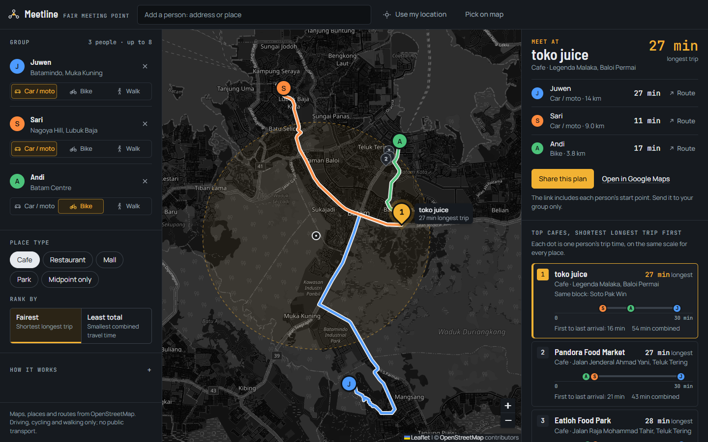

# Meetline

Find the fairest place for two or more people to meet, and the road route for each of them.

Add people by searching an address, using your current location, or tapping the map. Meetline looks for cafes, restaurants, malls or parks around the point where nobody travels too long, asks a road router for the real travel time from every person to every candidate, and ranks the places. Each person gets a coloured route on the map, a time, and a link that opens the same trip in Google Maps.

**Live:** https://juw12.github.io/meetline/  
**Sample group:** https://juw12.github.io/meetline/?demo



## What it does
- **2 to 8 people.** Search (Photon, then Nominatim as fallback; press Enter or the Add button), "Use my location" (browser geolocation, with live updates while the tab is open), "Pick on map", or right-click / long-press the map.
- **Live group (optional, new):** off by default. Tap Start in the Live group box below the options, enter your name, and send the invite link. Everyone who joins shares their position from their own phone; dots move as people travel ("Live · now", "Seen 12 min ago"), and the plan re-ranks at most every 45 s while keeping the chosen place selected. Updates are encrypted on the phone with AES-GCM; the room id and key live only in the link's `#fragment`, which browsers never send to a server. The public ntfy.sh relay only passes on ciphertext (cached a few hours). Leave stops sharing and tells the others.
- **Per-person travel mode:** drive, cycle, walk, or bus/train.
- **Place type:** cafe, restaurant, mall, park, or the exact fair point.
- **Two rankings:**
  - *Fairest* minimises the longest trip (minimax). Good when you do not want one person stuck in traffic for an hour.
  - *Least total* minimises the sum of all trips (geometric median). Good for fuel or overall time.
- **Real road times** from OSRM (car, bike and foot profiles). If the router is unreachable, Meetline falls back to straight-line estimates and says so.
- **Meeting plan:** pick a meeting time in the Meet at panel and every person gets a leave-by time (meeting time minus their trip). Each trip also shows as a bar that ends at the venue, so the person who has to leave first is obvious.
- **Bus and train times:** pick Transit for a person and Meetline asks Transitous (open GTFS timetables) for real trips to the shortlisted places, re-ranks, and shows the line ("Bus 105 · 9 min walk") with the route on the map. Where no timetable exists it falls back to a road-based estimate and says so.
- **Photos and reviews:** "Open in Google Maps" opens the Google Maps place page (searched by name at that spot) for photos, ratings and live traffic.
- **Fair zone:** the dashed ring on the map is labelled on desktop; it is the area around the fairest middle point where Meetline searches.
- **Arrival strip:** every ranked place shows one dot per person on a shared time axis, so you can see how balanced it is before reading any number.
- **Venue facts from OpenStreetMap:** when a place has `opening_hours`, the card says "Open now · until 22:00" or "Closed · opens tomorrow 08:00" (your device's local time). The Meet at panel also shows cuisine, takeaway, outdoor seating, wheelchair access and a website link when those tags exist. Hours the parser does not understand are shown as written, never guessed.
- **Share plan:** the whole plan (people, modes, place) is encoded in the link. Nothing is stored on a server. The link includes each person's start point, so send it to the group only, not a public post.
- Drag any marker to move a person; results update.

## Run it locally
Geolocation only works on `https://` or `http://localhost`, so serve the folder rather than opening the file directly.

```
start.bat
```
or
```
python -m http.server 8080
```
then open http://localhost:8080/ (add `?demo` for the sample group in Batam).

No build step and no API keys. Leaflet 1.9.4 is vendored in `vendor/leaflet`.

## How the fair point is found
1. Centre: minimax centre of everyone's position (fairest) or geometric median (least total), computed on a local flat projection.
2. Search radius: 30 % of the group's spread, clamped to 0.7-6 km.
3. Candidates: matching places from Photon / Nominatim inside that area, de-duplicated (same name within 60 m).
4. Times: one OSRM table request per travel mode, person x candidate.
5. Rank: by longest trip (or by total), ties broken by the other measure.

## Data sources and limits
- Map tiles: OpenStreetMap. Search: Photon (komoot) and Nominatim. Routing: OSRM via routing.openstreetmap.de. All free community services with fair-use limits; this app makes a handful of requests per search. For heavy use, point `window.MEETLINE_CONFIG` at your own tile, search and routing servers.
- Transit times depend on Transitous coverage: good in Singapore, Europe and North America, none for Batam at the time of writing (Meetline then shows an estimate and says so). Trips depart "now"; changing the meeting time does not re-query timetables. Leave-by times for cars use road times without live traffic.
- Live groups relay through the public ntfy.sh service (rate limited, best effort). A web page cannot share location in the background: a phone stops updating when its browser tab is closed or suspended, and others see "Seen x min ago".
- Venue details are only as good as OpenStreetMap; photos and ratings are in Google Maps behind the "Photos and reviews" link, not inside the app. Public holidays, seasonal hours and sunrise/sunset rules are not evaluated (shown as raw text).
- Venue coverage depends on OpenStreetMap data in your area.

## Project layout
- `index.html`, `style.css`: the app (dispatch-console design, see `design.md`).
- `src/geo.js`: pure geometry and ranking functions (minimax, median, ranking, share-link encoding).
- `src/app.js`: map, search, routing, transit and UI.
- `src/live.js`: live group crypto (AES-GCM) and the ntfy.sh relay connection.
- `src/base.css`: shared component styles.
- `src/demo-snapshot.js`: saved live result for the `?demo` sample group.
- `tests/geo.test.html`: unit tests for `geo.js` (open in a browser, or run `python tools/run_tests.py`).
- `tools/shoot.py`: screenshots at several widths; `tools/run_tests.py`: tests, empty state, demo and live checks; `tools/live_test.py`: two-phone live group and transit checks with a mocked relay (`--real` uses ntfy.sh).
- `directions/`: the four design directions that were compared before choosing this one.

## Licence
MIT, see `LICENSE`.
